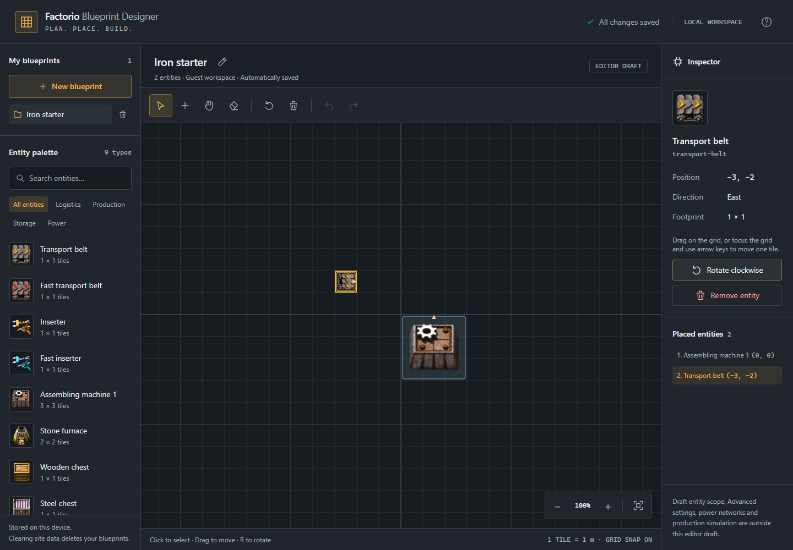

# Factorio Blueprint Designer

A first draft of the guest frontend editor, built with React, TypeScript, PixiJS, Zustand and Tailwind CSS. Blueprints save automatically to IndexedDB in the current browser; no account or backend is required.



## Current status

The Milestone 1 editor draft includes entity editing, multiple local blueprints and automatic IndexedDB saves. The latest implementation validation passed lint, the production build, 8 unit/storage tests and 6 Chromium browser workflows, including browser restart and offline editing. Full milestone acceptance remains tracked in [#27](https://github.com/NazarOps/FactorioBlueprintDesignerFE/issues/27).

| Remaining work | Tracking |
| --- | --- |
| Confirm the prototype list, Factorio version and desktop browser matrix | [#7](https://github.com/NazarOps/FactorioBlueprintDesignerFE/issues/7) |
| Complete application routing and CI; measure representative performance | [#8](https://github.com/NazarOps/FactorioBlueprintDesignerFE/issues/8), [#17](https://github.com/NazarOps/FactorioBlueprintDesignerFE/issues/17) |
| Wait for storage confirmation before removing deleted blueprints from the library UI | [#24](https://github.com/NazarOps/FactorioBlueprintDesignerFE/issues/24) |
| Complete accessibility and Milestone 1 acceptance checks | [#26](https://github.com/NazarOps/FactorioBlueprintDesignerFE/issues/26), [#27](https://github.com/NazarOps/FactorioBlueprintDesignerFE/issues/27) |
| Implement and verify Factorio blueprint-string import/export for Milestone 2 | [#18](https://github.com/NazarOps/FactorioBlueprintDesignerFE/issues/18), [#19](https://github.com/NazarOps/FactorioBlueprintDesignerFE/issues/19), [#20](https://github.com/NazarOps/FactorioBlueprintDesignerFE/issues/20), [#28](https://github.com/NazarOps/FactorioBlueprintDesignerFE/issues/28), [#29](https://github.com/NazarOps/FactorioBlueprintDesignerFE/issues/29) |

These are open acceptance gaps, not a claim that V1 is release-ready. [PROGRESS.md](PROGRESS.md) records detailed evidence and the commit-to-issue mapping.

## Run locally

```sh
npm ci
npm run dev
```

Use a current desktop browser with WebGL and IndexedDB enabled. The interface is designed for desktop editing; the full inspector appears at widths of 1280px and above.

## Editing

- Choose an entity from the palette and click the grid to place it. Search or filter the palette by category.
- Select an entity and drag to move it. Overlapping footprints are rejected; placement previews turn red when blocked.
- Use the toolbar or keyboard to rotate, remove, undo and redo. The inspector also lists placed entities for keyboard selection.
- Create, reopen, rename and delete blueprints from the local library. Deleting a blueprint requires confirmation.
- Wait for **All changes saved** before closing. Save errors preserve the in-memory draft and offer **Retry storage**.

| Action | Shortcut |
| --- | --- |
| Select / Place | V / B |
| Erase / Pan | E / H |
| Rotate clockwise | R |
| Remove selected | Delete / Backspace |
| Undo / Redo | Ctrl/Command Z / Ctrl/Command Shift Z |
| Pan | Hold Space and drag on the grid, middle-drag, or use Pan |
| Zoom | Mouse wheel or view buttons |
| Fit layout | Home |
| Deselect / cancel drag | Escape |
| Move selected by one tile | Arrow keys with the grid focused |

Shortcuts do not intercept typing in forms. Undo history lasts for the current editing session/document; saved entity data survives reload and browser closure.

## Draft scope and storage

The provisional palette includes transport belts, fast transport belts, inserters, fast inserters, assembling machine 1, stone furnaces, wooden chests, steel chests and small electric poles. Positions use integer tile coordinates at the top-left of each footprint; cardinal directions are internal editor values, not Factorio serialized directions.

Original game assets may be provided locally under ignored `public/assets/factorio/item/`. They are optional: the palette and grid use schematic fallbacks without them. Assets are never downloaded from a remote service by the app.

Storage is local to this browser and origin. Clearing site data removes blueprints. Use a single editing tab: this draft does not synchronize concurrent tab edits. There is no cloud backup. Editing works without a network connection once the app has loaded; a service worker for offline first-load is outside this draft.

Factorio blueprint-string import/export is **not implemented**. This delivers the editor draft around Milestone 1; full V1 also requires Milestone 2 and confirmed game compatibility. Exact prototype compatibility, browser support and performance limits remain open decisions.

## Validation

```sh
npm run lint
npm run build
npm test
npx playwright install chromium
npm run test:e2e
```

Vitest covers domain commands and IndexedDB persistence using fake-indexeddb. Playwright exercises the actual canvas, browser storage, reload/reopen, offline edits, save failure/retry, asset fallback, zoom and browser restart. Browser tests start a Vite server at `127.0.0.1:5174`; traces and screenshots go to ignored `test-results/`. On Windows with PowerShell execution policies, invoke `npm.cmd` / `npx.cmd`.

## Project guidance

- [V1 requirements](docs/Factorio_Blueprint_Designer_V1_Requirements.md)
- [Progress and validation log](PROGRESS.md)
- [Coding standards](docs/coding-standards/README.md)
- [Project structure](docs/project-structure/README.md)
- [Tech stack](docs/tech-stack/README.md)
- [Repository instructions](AGENTS.md)
- [Frontend issue tracker](https://github.com/NazarOps/FactorioBlueprintDesignerFE/issues)

`src/app/` composes the UI; `features/editor/` owns commands and rendering; `features/blueprints/` owns document models, management UI and persistence; `shared/` supplies database plumbing and reusable controls. Future Factorio serialization belongs in its own feature boundary.

## Contributing and issue references

Read the V1 requirements and relevant frontend issues before implementation, including their acceptance criteria and dependencies. The requirements document and explicit scope decisions govern the work.

- Reuse existing issues. When agreed requirements change and the new scope is not already tracked, create an issue before implementation with the reason, requirement IDs, acceptance criteria, dependencies and verification plan.
- Make small, focused Conventional Commits and reference matching issues in their bodies, for example `Refs: #11, #13`. Use `Closes #N` only after the entire issue's acceptance criteria are implemented and verified.
- Keep `PROGRESS.md` current with behavior, issue references, validation results and remaining gaps. PRs should link issues, explain the resulting behavior and include screenshots for UI changes.
- Run lint, build and the tests relevant to the change. Record actual results and any verification limits.

The complete workflow is defined in [AGENTS.md](AGENTS.md).
